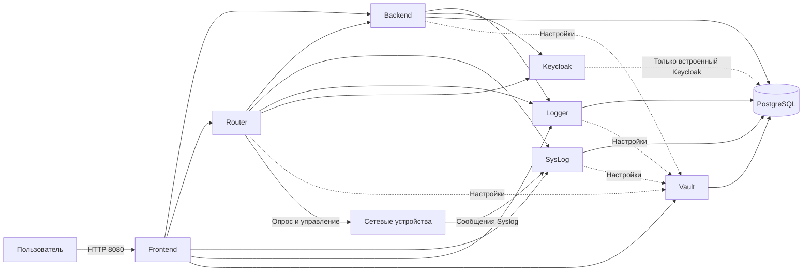
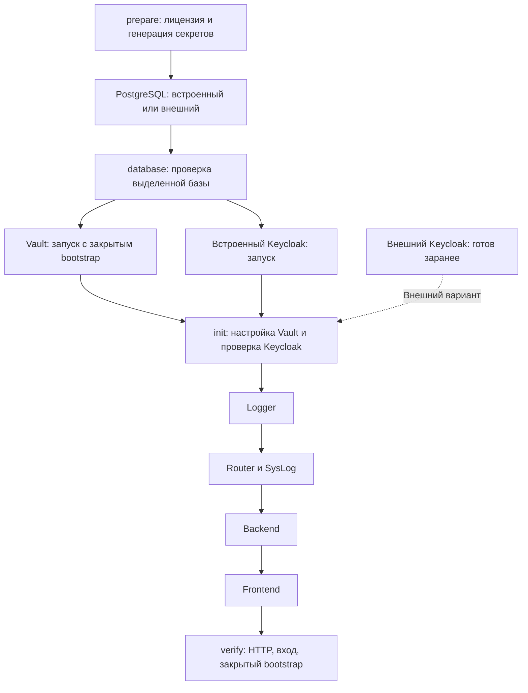

# Схема взаимодействия служб

## Оглавление

- [Работа приложения](#runtime)
- [Подготовка и проверка](#startup)
- [Четыре варианта](#variants)

## Работа приложения

Frontend предоставляет интерфейс. Backend обрабатывает запросы и проверяет права через Keycloak. Router работает с устройствами, SysLog принимает сообщения устройств, Logger хранит журналы. Vault выдаёт настройки служб. PostgreSQL хранит данные приложений. Имена узлов обозначают службы, а не конкретные серверы.

Внешний Keycloak использует собственную инфраструктуру хранения. Его база не обязана совпадать с базой UnicNet; связь Keycloak → PostgreSQL на схеме относится только к встроенному Keycloak.

## Подготовка и проверка

Задания prepare/database/init/verify запускаются из готового образа unicnetinit и завершаются с кодом 0. Остальные службы работают постоянно. Связи на второй схеме показывают порядок готовности, а не сетевые запросы. При встроенном PostgreSQL база стартует после prepare; внешний PostgreSQL и внешний Keycloak готовит администратор до установки.

## Четыре варианта

1. Все службы встроены: `compose.yml` + `compose.pg.yml` + `compose.keycloak.yml`.
2. Внешний PostgreSQL: `compose.yml` + `compose.keycloak.yml`.
3. Внешний Keycloak: `compose.yml` + `compose.pg.yml`.
4. Обе службы внешние: только `compose.yml`.

Готовые настройки выбора описаны в [основной инструкции](../README.md#variants). Docker Compose сам создаёт внутреннюю сеть. Подключения к существующим службам задаются в infrastructure.json.
