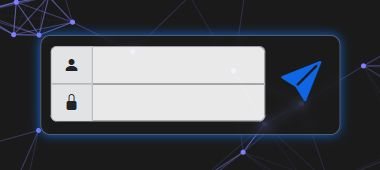
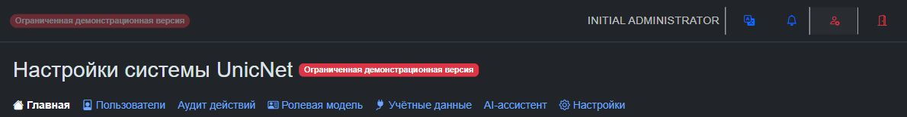

# Первый вход и права UnicNet

## Оглавление

- [1. Первый вход](#first-login)
- [2. Персональный администратор UnicNet](#personal-admin)
- [3. Атрибуты пользователей и групп](#attributes)
- [4. Наследование и проверка прав](#inheritance)
- [5. Персональный администратор Keycloak](#keycloak-admin)
- [6. Первое устройство и его события](#first-device)
- [7. Результат настройки пилота](#pilot-result)

Документ предназначен администратору уже установленного UnicNet. Здесь описаны первый вход, персональные учётные записи и подключение первого устройства. Если установка ещё не завершена, начните с [основной инструкции](../INITIAL_DEPLOYMENT.md).

## 1. Первый вход

Ниже описан встроенный Keycloak. Для внешнего Keycloak используйте выбранный realm и реквизиты из [инструкции подключения внешних служб](EXTERNAL-SERVICES.md#section-4). Администратор приложения UnicNet не получает административных прав в Keycloak автоматически.

Откройте **initial-admin.json локально на сервере** или получите его через защищённый канал. В нём указаны:

- UnicNet: `http://<host>:8080/`;
- Keycloak: `http://<host>:8095/admin/master/console/`;
- логин `admin` и случайный пароль этого стенда.

На странице UnicNet введите логин в верхнее поле, пароль — в нижнее и нажмите кнопку со стрелкой справа.

После входа откройте **Настройки системы UnicNet** кнопкой в верхней панели справа от колокольчика уведомлений. В настройках доступны разделы **Пользователи**, **Ролевая модель** и **Учётные данные**.

Для первого входа используются одинаковые реквизиты. Технически это две учётные записи в разных realms: `master` для администрирования Keycloak и `unicnet` для приложения. Последующая смена пароля одной записи не меняет пароль другой автоматически.

Администратор Keycloak получает полные административные права. Администратор UnicNet получает роль `Admin`, группу `Administrators` и разрешения `write` для разделов UN/UA. Доступ к модулям по-прежнему зависит от лицензии; права администратора не заменяют лицензию.

Сначала создайте [персонального администратора UnicNet](#personal-admin); при необходимости отдельно назначьте [администратора Keycloak](#keycloak-admin). Отключайте начальные записи только после проверки персонального доступа. Учётная запись **unicnet-service** используется приложениями: смена пароля пользователя `admin` не меняет её реквизиты.

Дальнейшую настройку выполняйте через Keycloak и UnicNet. Не редактируйте импортированный JSON для изменения работающего realm: он используется только для первого создания.

## 2. Персональный администратор UnicNet

1. Войдите в консоль Keycloak учётной записью администратора этой службы.
2. Выберите realm **unicnet**; для внешнего Keycloak — realm, указанный в `infrastructure.json`. Realm `master` для этого пользователя не подходит.
3. В разделе **Users** создайте пользователя сотрудника и включите его учётную запись (**Enabled**).
4. В разделе **Credentials** задайте пароль. Если назначена обязательная смена пароля или другие **Required actions**, сотрудник должен завершить их через Keycloak до входа через форму UnicNet.
5. В разделе **Groups** пользователя добавьте его в группу **Administrators**. Группа, созданная установщиком, уже содержит роль и разрешения полного доступа; переносить атрибуты вручную каждому администратору не нужно. Для заранее существовавшего realm группу готовит его администратор по [инструкции](EXTERNAL-SERVICES.md#existing-realm).
6. В отдельном окне браузера войдите этим пользователем в UnicNet. Проверьте открытие системных настроек и раздела пользователей. Только после успешной проверки отключайте начальную запись `admin` в realm приложения.

Если права задаёте **не через группу, а непосредственно пользователю**, добавьте `access_level=admin` и все перечисленные ниже атрибуты `_grants` со значением `write`. Одной роли `admin` или одного `access_level=admin` недостаточно для всех действий: роль и разрешения разделов проверяются отдельно.

## 3. Атрибуты пользователей и групп

Атрибуты добавляет администратор Keycloak. Для произвольных атрибутов пользователя в realm должна разрешаться политика unmanagedAttributePolicy=ADMIN_EDIT; Backend пытается настроить её при старте. Если атрибуты нельзя добавить или сохранить, сначала проверьте эту настройку и права администратора.

Имена и значения вводите без кавычек, например имя `map_grants`, значение `write`. Для каждого параметра достаточно одного значения. Используйте одно основное имя `access_level`, не создавая одновременно несколько противоречащих друг другу вариантов роли.

| Атрибут | Значение для полного администратора | Область действия |
|---|---|---|
| `access_level` | `admin` | Уровень роли в UnicNet. `user` — обычный пользователь, `superUser` — расширенная роль, `admin` — администратор. Сам по себе не выдаёт разрешения на запись во всех разделах |
| `admin_grants` | `write` | Раздел администрирования UN: системные настройки, административные операции, политики доступа к устройствам и управление реквизитами в пределах требуемой роли |
| `directory_grants` | `write` | Просмотр каталога пользователей и групп через UN. Создание и изменение записей дополнительно требуют роль Admin и admin_grants=write; directory_grants само по себе этих прав не даёт |
| `runbook_grants` | `write` | Устройства, реквизиты доступа к устройствам, CLI, задачи RunBook и связанные операции опроса/управления |
| `map_grants` | `write` | Карты сети: просмотр, изменение и операции с картами и экспортом в пределах доступных функций |
| `assistant_grants` | `write` | AI-ассистент: работа с чатами и запросами. Дополнительно нужна настроенная интеграция ассистента |
| `objects_grants` | `write` | Объекты UA и справочники объектов: просмотр, создание и изменение |
| `arch_schemes_grants` | `write` | Схемы UA: просмотр и редактирование |
| `arch_approvals_grants` | `write` | Согласования UA. Для отдельных действий, например принятия решения, дополнительно требуется роль Admin |
| `cal_grants` | `write` | Производственный календарь UA: просмотр и изменение |
| `arch_settings_grants` | `write` | Настройки UA; применяются в проверках этого раздела вместе с требованиями к роли |
| `arch_acl_grants` | `write` | Право каталога для модели доступа UA. Текущий API /api/acl защищён ролью Admin; отдельной проверки arch_acl_grants в этом контроллере нет |

Для всех атрибутов `_grants` используются три значения:

| Значение | Что разрешено |
|---|---|
| `none` | Доступ к операциям соответствующего раздела, защищённым этим правом, запрещён |
| `read` | Просмотр/чтение без операций, требующих `write` |
| `write` | Просмотр и операции записи/управления, если выполняются остальные требования к роли, лицензии и конкретному объекту |

Обычному пользователю задавайте `access_level=user` и только необходимые права. Например, оператору просмотра карты: `map_grants=read`, а ненужным разделам явно `none`. Пользователю, которому разрешены операции с устройствами, нужен `runbook_grants=write`; некоторые административные действия всё равно требуют более высокой роли. Для ограниченного пользователя не используйте группу Administrators.

Отсутствие атрибута не означает гарантированный запрет: часть проверок использует совместимый уровень `read` по умолчанию. Если доступ нужно закрыть, укажите `none` явно.

## 4. Наследование и проверка прав

При входе/обновлении пользователя с ролью Admin и административной группой (имя или путь содержит admin) UN дополняет его права до write для разделов каталога включённых модулей. Не используйте такую группу для администраторов с ограниченными правами.

Атрибуты роли и разрешений читаются как у пользователя, так и у его групп. Разрешение, явно записанное пользователю, имеет приоритет над групповым; среди разрешений нескольких групп выбирается максимальное. Для роли выбирается наиболее привилегированный распознанный уровень: пользователь с `access_level=user`, состоящий в административной группе, не становится ограниченным пользователем.

Для совместимости код распознаёт также атрибуты роли `accessLevel`, `role` и `roles`, а роль может приходить из realm roles. Для новых пользователей используйте `access_level` и согласованные назначения групп/ролей. `Blocked`, `None` и `Service` не используйте как способ настройки обычного пользователя: для блокировки отключите пользователя в Keycloak, а Service предназначен для служебных JWT.

Имя, фамилия и email — обычные поля профиля: они не предоставляют административные права. Произвольные атрибуты, например `department`, сами по себе тоже не расширяют доступ.

После изменения ролей, групп или атрибутов выйдите из UnicNet и войдите снова, чтобы получить токен с обновлёнными правами. Проверьте нужный раздел под новым пользователем до отключения начального администратора. Доступ к UN/UA дополнительно ограничен лицензией: атрибуты не включают нелицензированный модуль.

## 5. Персональный администратор Keycloak

Атрибут `access_level=admin` относится к приложению и не делает пользователя администратором консоли Keycloak. Если сотруднику нужен полный доступ и туда, создайте ему отдельную персональную запись в realm **master** и назначьте realm role **admin**. Для приложения нужна запись в realm **unicnet** с правами из этого раздела. Это две записи, их пароли не синхронизируются автоматически.

Служебную учётную запись `unicnet-service` не используйте для повседневного входа сотрудников и не удаляйте вместо начального администратора.

## 6. Первое устройство и его события

Выберите одно согласованное устройство для проверки. Его адрес должен быть доступен Router, а устройство должно разрешать выбранный протокол управления и вход с используемыми реквизитами. Функции опроса и приёма событий должны входить в выданную лицензию. Начальный пустой список устройств после установки является нормальным состоянием.

1. Откройте системные настройки UnicNet и раздел **Учётные данные**. Создайте запись доступа к устройству с уникальным названием, нужным протоколом и реквизитами. В руководстве пользователя v1.9 этот раздел называется «Подключения» (раздел 2.3).
2. Откройте **Список устройств**, выберите **Добавить устройство** и укажите IP-адрес выбранного устройства. Если известен вендор, укажите его. Подробности: раздел 4.1 «Панель управления списком».
3. В контекстном меню устройства откройте **Информация** и проверьте параметры подключения. Выполните **Обновить инфо**. Ожидаемый результат — завершение задачи обновления без ошибки и получение сведений, доступных по выбранному протоколу. Подробности: раздел 4.2 «Контекстное меню».
4. Если нужен автоматический поиск, создайте в **Runbook** задачу типа **Дискаверинг**, задайте согласованный диапазон и порядок выполнения. Проверку начните с небольшого диапазона. Подробности: разделы 10.3–10.5 руководства. Задание `UNICNET_CIDR` при установке само по себе не подтверждает выполненный опрос устройств.
5. Для проверки Syslog администратор устройства должен настроить отправку событий на адрес сервера UnicNet и согласованный опубликованный порт. Выберите транспорт из [описания сети](OPERATIONS.md#network), соответствующий настройкам устройства; эта инструкция не меняет конфигурацию самого устройства.
6. В разделе **Логи устройств** выберите устройство и временной диапазон, включающий отправку события, и нажмите **Показать**. Ожидаемый результат — отображение отправленного устройством события. Подробности: раздел 6 руководства.

При ошибке опроса проверьте задачу в Runbook, **Логи системы**, реквизиты и сетевой доступ. При отсутствии Syslog проверьте отправителя, адрес назначения, транспорт, правила сети и временной фильтр. Успешная установка контейнеров не подтверждает доступ к конкретному устройству.

Руководство: [PDF](../User.Guide.UnicNet.v1.9.pdf) или [DOCX](../User.Guide.UnicNet.v1.9.docx). Названия и расположение элементов интерфейса могут отличаться от версии 1.9; при отличиях используйте назначение раздела и согласуйте действия с поддержкой.

## 7. Результат настройки пилота

Настройка пилота завершена, когда подтверждены все согласованные для него действия:

- выполнены критерии готовности из [основной инструкции](../INITIAL_DEPLOYMENT.md#login);
- проверен вход персонального администратора и его доступ к настройкам;
- получены сведения хотя бы об одном выбранном устройстве;
- получено тестовое событие Syslog, если приём событий входит в пилот;
- назначены ответственные за конфигурацию устройств, хранение данных и поддержку внешних служб.

Для передачи результата поставщику достаточно обозначения выпуска, выбранного варианта и описания выполненных проверок. Реквизиты устройств, пользователей, лицензию и рабочие файлы настройки не прикладывайте.
